# How the service works: flows

A guided tour of each flow, from the simplest to the trickiest. Every diagram matches the code, and each section links to the file that implements it.

- [1. The big picture](#1-the-big-picture)
- [2. Lifecycles: cart and coupon](#2-lifecycles-cart-and-coupon)
- [3. Editing a cart](#3-editing-a-cart)
- [4. Checkout: one transaction, eight steps](#4-checkout-one-transaction-eight-steps)
- [5. Why there are no deadlocks: the lock order](#5-why-there-are-no-deadlocks-the-lock-order)
- [6. Race: two customers, one last item](#6-race-two-customers-one-last-item)
- [7. Race: a client retries checkout](#7-race-a-client-retries-checkout)
- [8. Race: editing a cart during checkout](#8-race-editing-a-cart-during-checkout)
- [9. Coupon generation](#9-coupon-generation)
- [10. Coupon redemption](#10-coupon-redemption)
- [11. The admin report](#11-the-admin-report)
- [12. Which layer enforces what](#12-which-layer-enforces-what)

---

## 1. The big picture

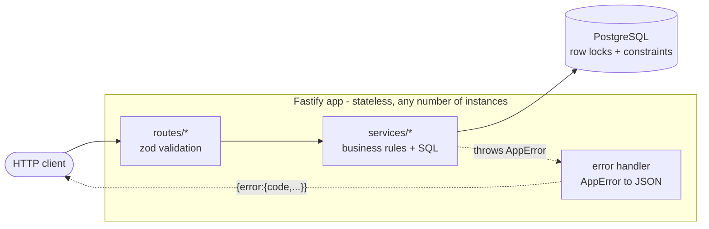

- **Routes** ([src/routes/](../src/routes/)) only validate input and shape output.
- **Services** ([src/services/](../src/services/)) hold every rule and run hand-written SQL.
- **PostgreSQL** is the only place where concurrency is controlled: row locks (`FOR UPDATE`), conditional updates, and `CHECK`/`UNIQUE` constraints. The app keeps no in-memory locks or caches, so running two app instances changes nothing.

---

## 2. Lifecycles: cart and coupon

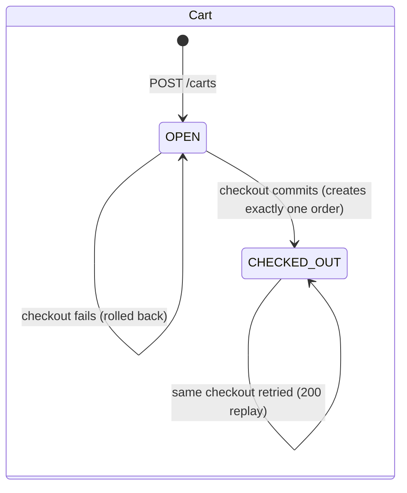

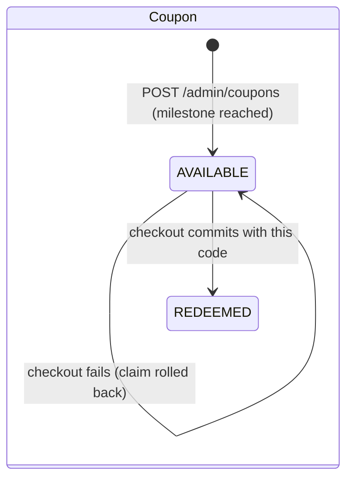

Neither goes backwards. A checked-out cart can't be edited (409), and a redeemed coupon can't be reused (409).

---

## 3. Editing a cart

`PUT /carts/:id/items/:productId` and `DELETE ...` in [cartService.ts](../src/services/cartService.ts).

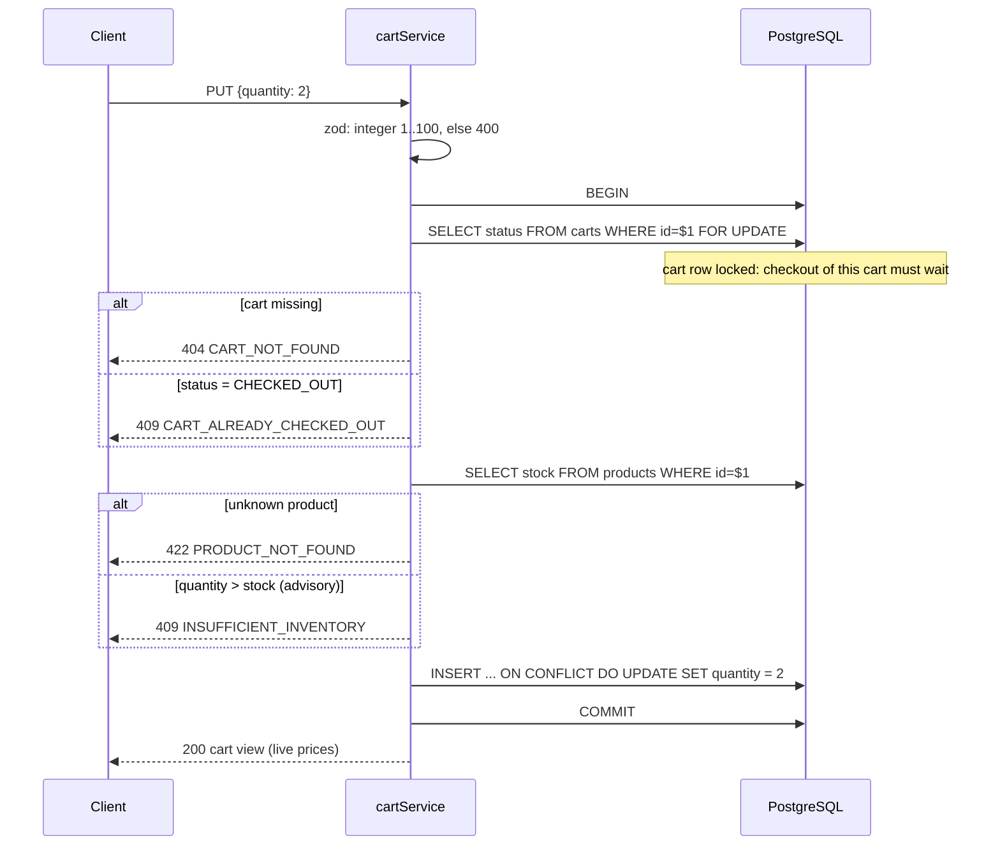

- **PUT sets an absolute quantity**, so a retried PUT changes nothing. A "+1" POST would double-add on retry.
- **The stock check here is only advisory.** Nothing is reserved; checkout checks again under lock.
- **The cart view always shows live prices.** If stock fell below a cart line's quantity, the view shows a `warning` for that line.

---

## 4. Checkout: one transaction, eight steps

`POST /carts/:id/checkout` in [checkoutService.ts](../src/services/checkoutService.ts). Every box below runs inside **one** `BEGIN ... COMMIT`. Any red exit is a `ROLLBACK`, which undoes everything, including the coupon claim.

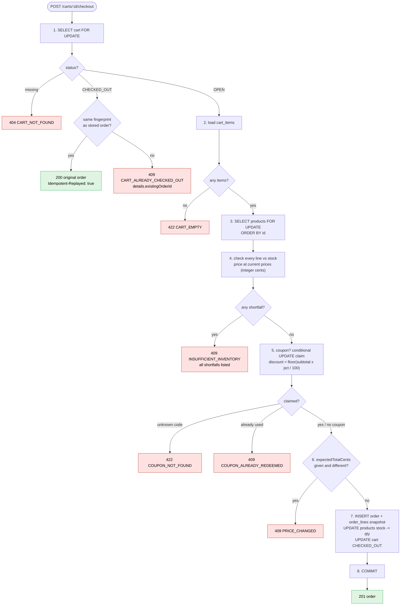

What to notice:

- **The replay check comes first.** If the first attempt succeeded but its response was lost, the retry must return that order, even if stock has since run out. Checking stock first would wrongly turn a success into a 409.
- **Fingerprint = the normalized coupon code** (`"save-ab12 "` becomes `"SAVE-AB12"`, or `null`). Same cart and same fingerprint is a replay. Same cart with a different fingerprint is a conflict.
- **The order is a snapshot.** It stores product name, unit price, quantity, line total, subtotal, discount, percent and coupon code. `GET /orders/:id` never reads `products`.
- **Failures are never cached.** A 409 leaves the cart `OPEN`, so the client can fix the problem and retry.

---

## 5. Why there are no deadlocks: the lock order

Every transaction that takes more than one lock takes them in the same order:

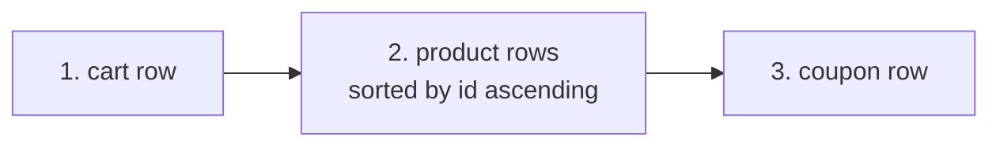

A deadlock needs two transactions each holding something the other wants. Suppose cart A contains `[mug, cap]` and cart B contains `[cap, mug]`:

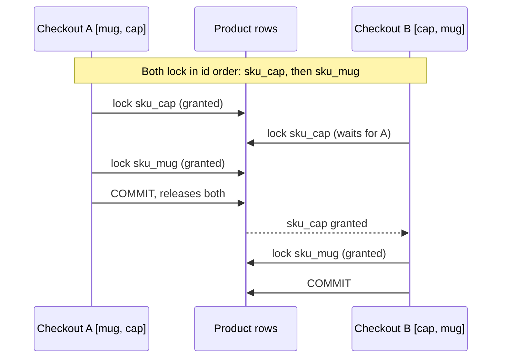

If each locked in the order its items were added, A would hold mug while B held cap, and each would wait on the other forever. Postgres would detect that and kill one of them with error 40P01 (a 500). The test `30 carts with the same two products in opposite orders` catches the realistic bug, locking in cart order: it then fails with 500s. Be precise about what it does **not** prove. Simply deleting `ORDER BY id` still passes, because on a 6-row table every transaction's seq scan locks rows in the same physical order. That order is not guaranteed in general (a different plan, or synchronized seq scans on a large table, can change it), so `ORDER BY id` is the guarantee rather than an accident.

---

## 6. Race: two customers, one last item

`sku_print` has stock 1. Two different carts check out at the same instant.

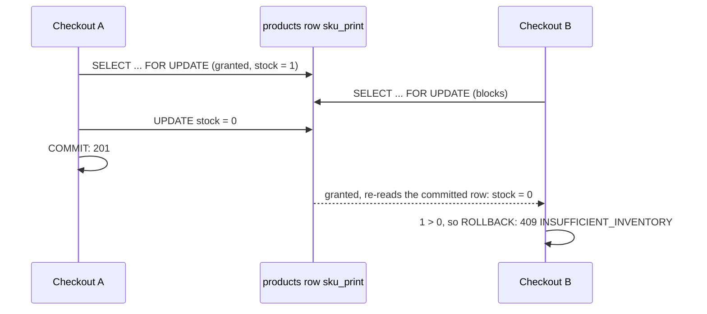

Under `READ COMMITTED`, a `FOR UPDATE` that had to wait returns the **latest committed** version of the row, so B never acts on the stale `stock = 1`. The `CHECK (stock >= 0)` constraint is the second line of defence: if the lock were ever missing, the bad decrement would fail instead of overselling.

---

## 7. Race: a client retries checkout

The client times out and fires the same checkout again while the first is still running.

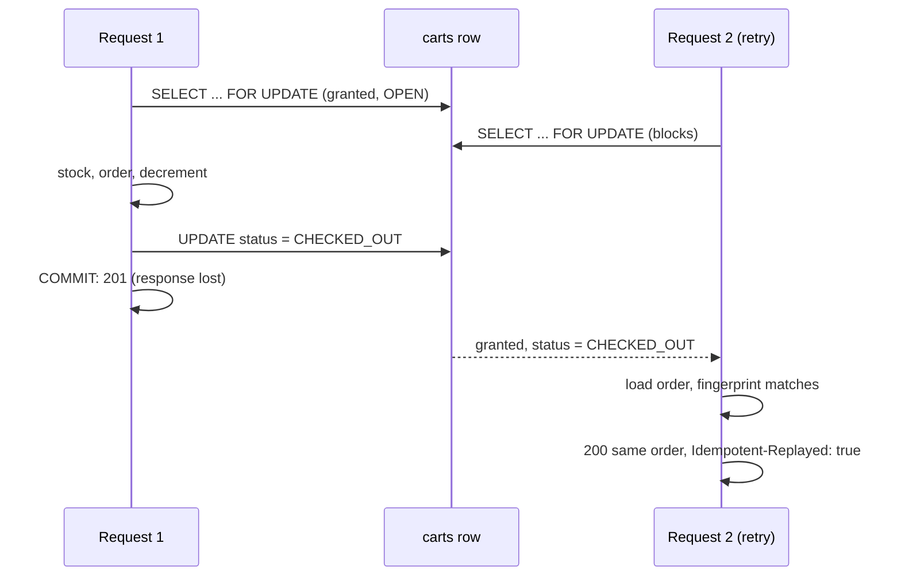

The cart id is the idempotency key, and the cart row lock serializes the attempts. The second attempt never reaches the stock step, so stock is decremented exactly once. `UNIQUE(orders.cart_id)` backs this up in the database.

---

## 8. Race: editing a cart during checkout

Both paths lock the same cart row, so they can only run one after the other:

| Who locks first | What happens to the other | Outcome |
|---|---|---|
| The edit (PUT quantity 2) | Checkout waits, then reads the edited items | Order has quantity 2 |
| Checkout | The edit waits, then sees `CHECKED_OUT` | PUT gets 409; order has quantity 1 |

There is no third outcome where the order says 1 and the cart says 2. That's what the `edit vs checkout race` test checks, ten times.

---

## 9. Coupon generation

`POST /admin/coupons` in [couponService.ts](../src/services/couponService.ts). With n = 3: 3 orders reach milestone 1, 6 orders reach milestone 2, and so on.

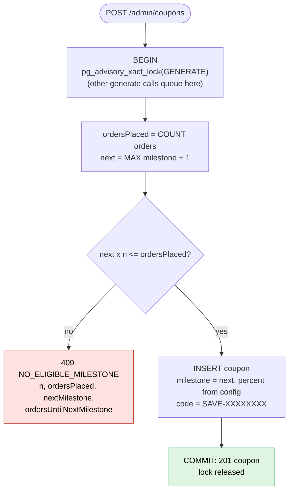

Ten admin calls at once with 6 orders placed (n = 3, so milestones 1 and 2 are pending):

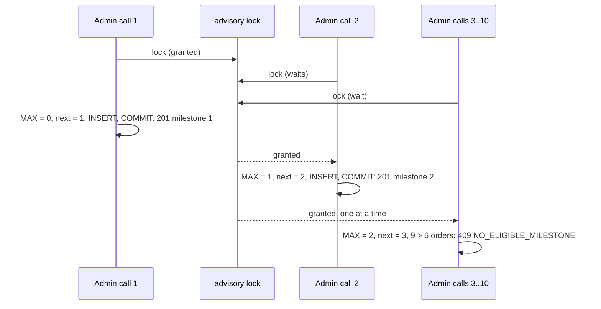

**Two layers.** The advisory lock (a Postgres lock, so it works across app instances, released automatically at COMMIT/ROLLBACK) makes generate calls run one at a time, so each sees the previous call's coupon. `UNIQUE(milestone)` is the backstop: without the lock, duplicates are refused (as 500s) rather than created.

**Why not "insert and retry on a unique violation"?** That was the first version. Review showed that with many pending milestones and many simultaneous calls, the losers kept losing and exhausted the retries: 12 calls for 12 milestones gave 3 × 201 and 9 × 500. Serializing removes the race instead of retrying it. Generation is a rare admin action, so queuing costs nothing.

A stale order count is safe. Orders are never deleted, so a count that misses a just-committed order is only ever too low. That can only make us say "not yet" a moment early. It can never mint a coupon for a milestone that hasn't been reached.

---

## 10. Coupon redemption

Step 5 of checkout. The claim is **one conditional statement**, never a read followed by a write:

```sql
UPDATE coupons SET status = 'REDEEMED', redeemed_at = now()
 WHERE code = $1 AND status = 'AVAILABLE'
RETURNING id, code, percent
```

Two carts use the same coupon at the same instant:

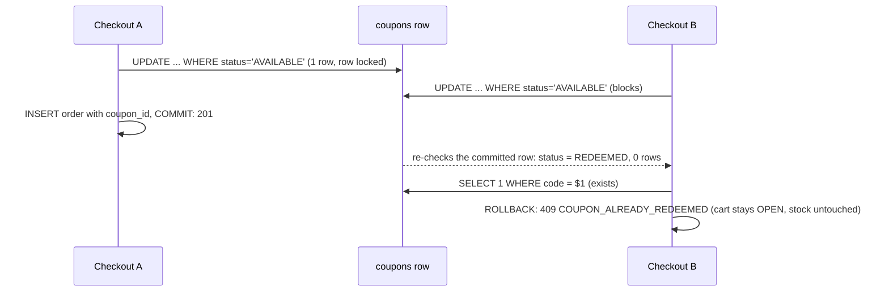

**Why a failed checkout never "uses up" a coupon:** the claim is part of the checkout transaction. If anything later fails (for example `PRICE_CHANGED`), the `ROLLBACK` reverts the `UPDATE`, and the coupon is `AVAILABLE` again. If A had rolled back in the diagram above, B would have claimed the coupon instead.

`UNIQUE(orders.coupon_id)` backs this up: even a buggy claim could never attach one coupon to two committed orders.

**Discount math (integer cents, rounded down in the customer's favour):**

| subtotal | percent | exact | discount | total |
|---|---|---|---|---|
| 1299 | 10 | 129.9 | **129** | 1170 |
| 999 | 33 | 329.67 | **329** | 670 |
| 5 | 10 | 0.5 | **0** | 5 |
| 5999 | 100 | 5999 | **5999** | 0 (never negative) |

---

## 11. The admin report

`GET /admin/report` in [reportService.ts](../src/services/reportService.ts).

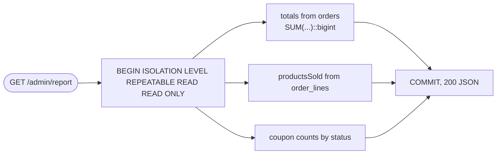

- **One snapshot.** With `READ COMMITTED`, an order committing between the totals query and the order_lines query could make the product quantities disagree with the revenue. `REPEATABLE READ` gives all three queries the same snapshot.
- **Read only.** Postgres itself rejects any write in this transaction, so calling the report can never change state.
- **Nothing is stored.** Every figure can be recomputed from `orders`, `order_lines` and `coupons`, and the test does exactly that from `GET /orders/:id` responses.

---

## 12. Which layer enforces what

| Invariant | App logic | Database backstop | Test that proves it |
|---|---|---|---|
| I1 never oversell | products `FOR UPDATE` + stock check | `CHECK (stock >= 0)` | `concurrency.checkout`: 20 carts race for 3 units |
| I2 one order per cart | cart `FOR UPDATE` + status check | `UNIQUE (orders.cart_id)` | retry storm |
| I3 idempotent checkout | replay check first + fingerprint | `UNIQUE (orders.cart_id)` | retry storm; sequential replay |
| I4 coupon single use | conditional `UPDATE ... AND status='AVAILABLE'` in the checkout tx | `UNIQUE (orders.coupon_id)` | `concurrency.coupons-redeem`; coupon survives failure |
| I5 one coupon per milestone | advisory lock + eligibility check | `UNIQUE (coupons.milestone)` | `concurrency.coupons-generate` |
| I6 totals reconcile | `money.ts` integer math | `CHECK (total = subtotal - discount)`, `CHECK (discount <= subtotal)` | `money.test`, `schema.test` |
| I7 immutable snapshots | orders read only `orders` / `order_lines` | n/a | snapshot survives price change |
| I8 report reconciles, never writes | one `REPEATABLE READ READ ONLY` tx | read-only transaction | `report.test` |
